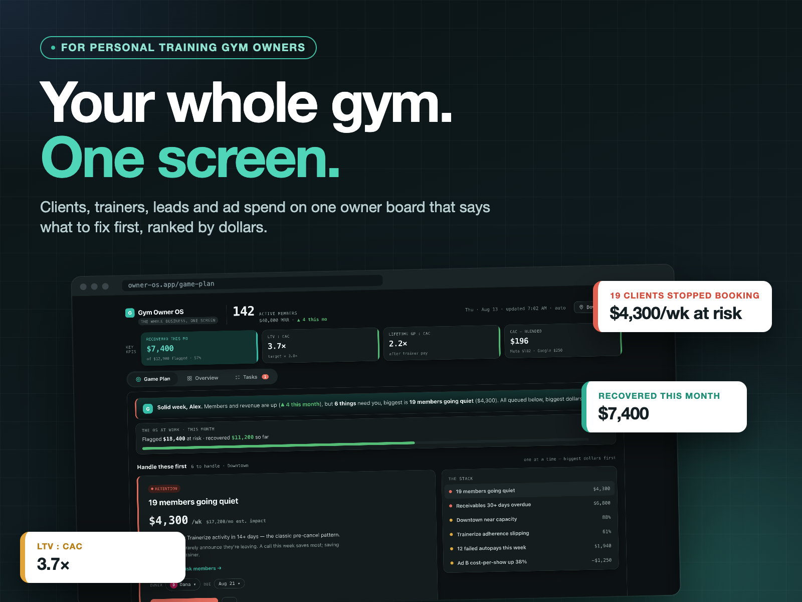
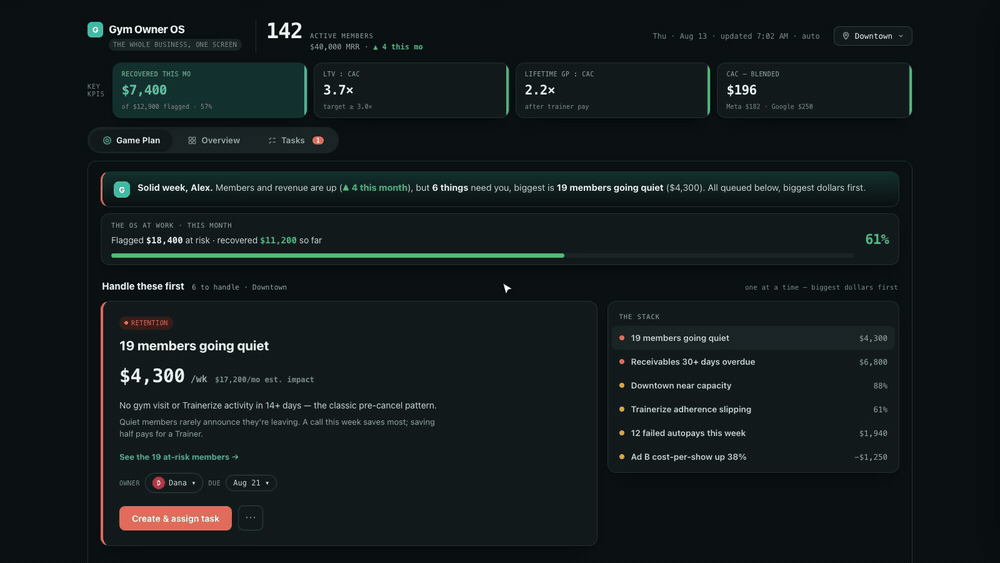
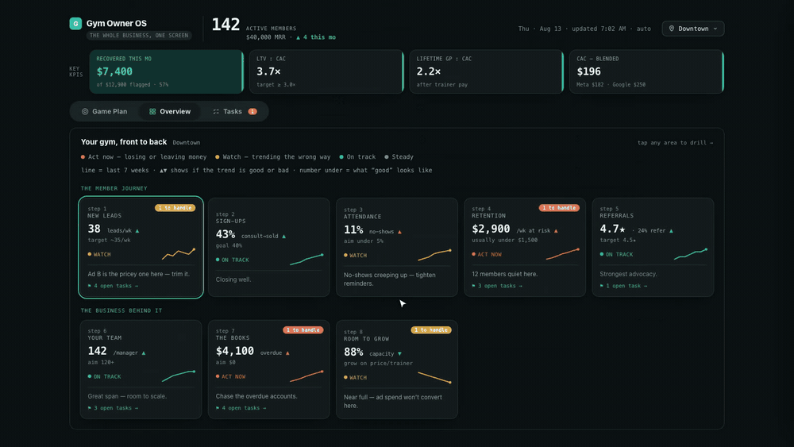
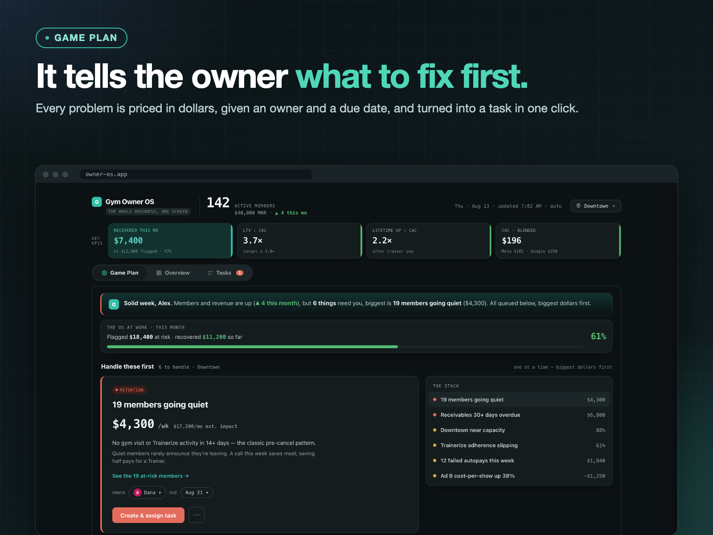
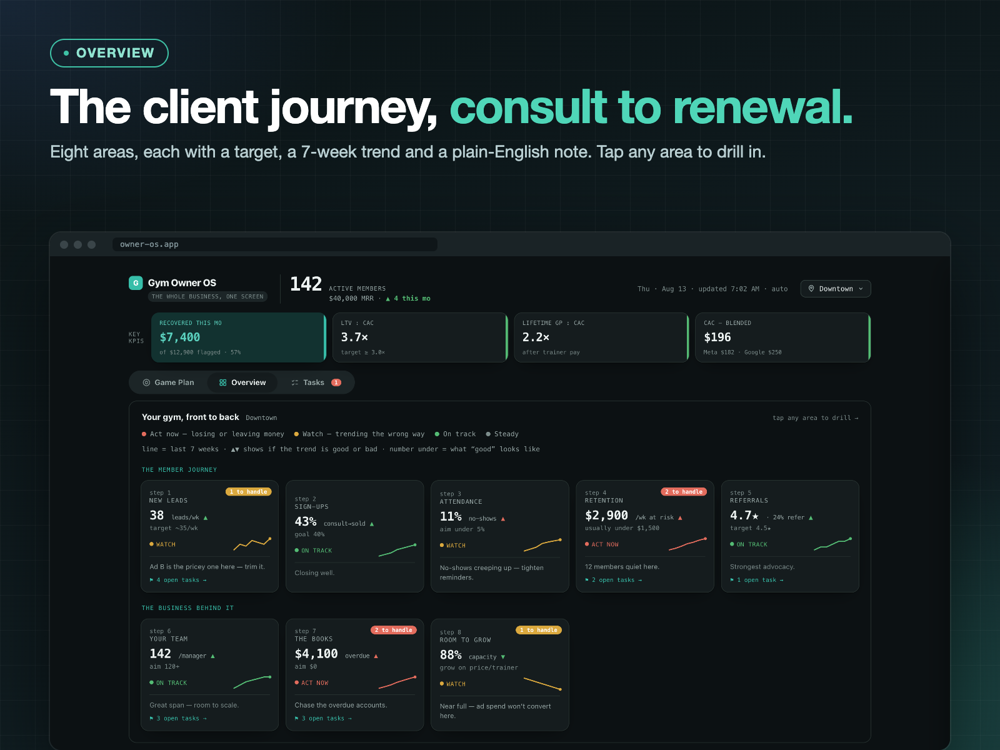
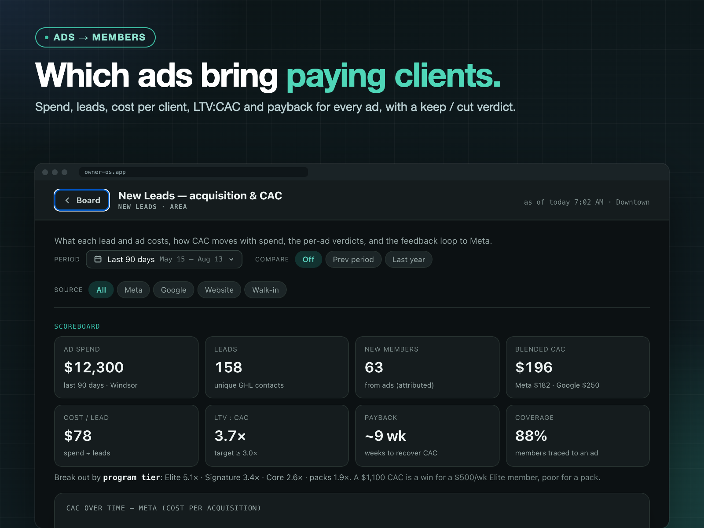
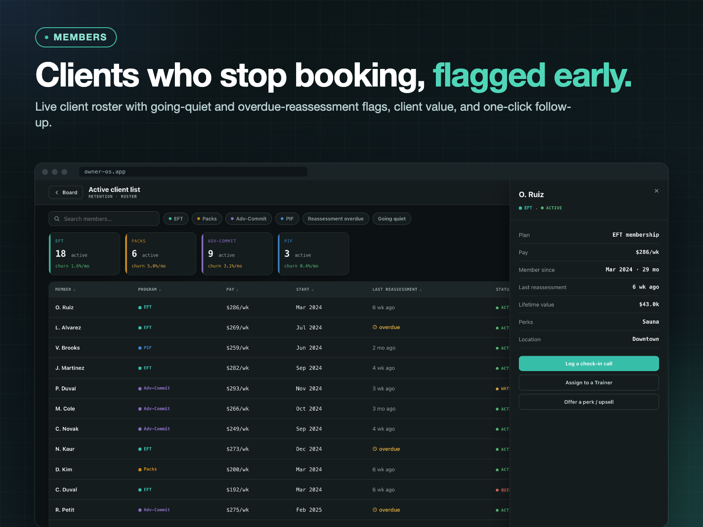
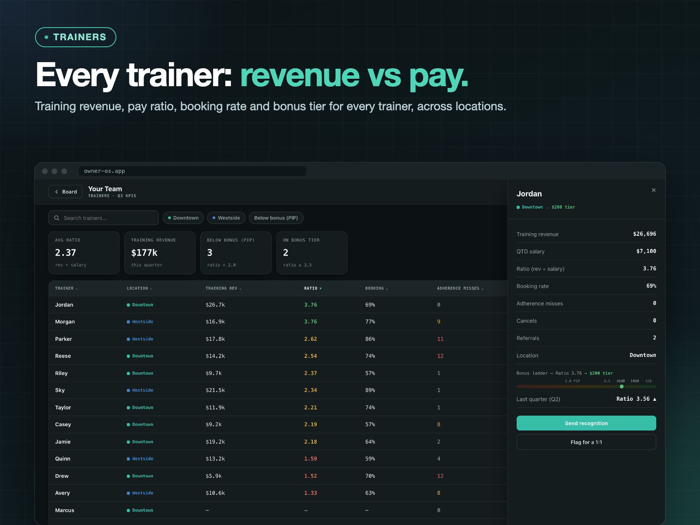
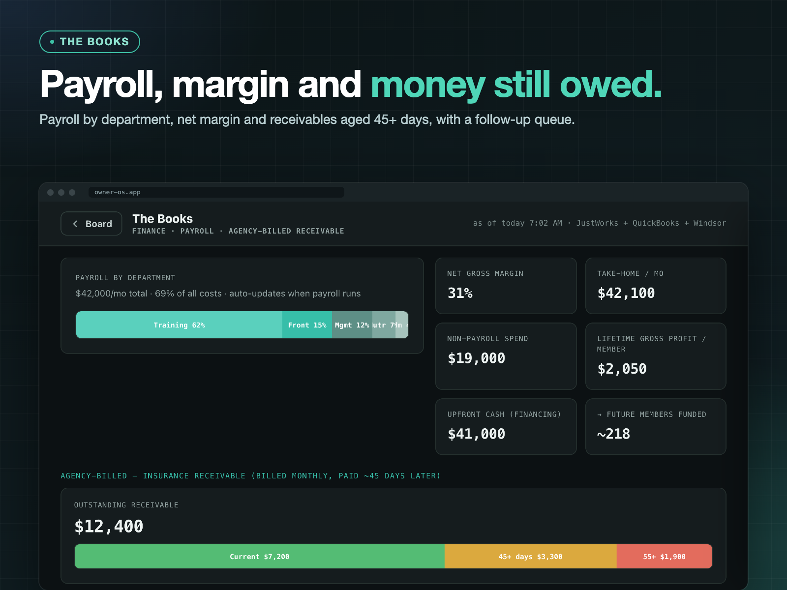
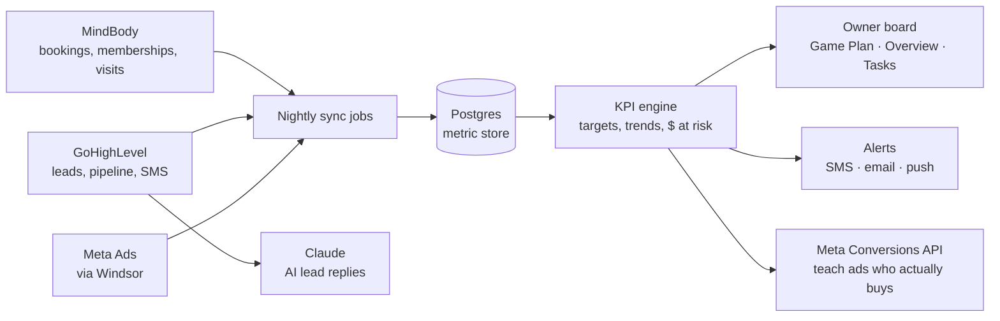

# Gym Owner OS

**The operating system for personal training gym owners.** Clients, trainers, leads and ad spend on one screen, ranked by dollars at risk. It tells you what to fix first, assigns it to someone, and tracks what that saved.

[](docs/media/demo.mp4)

▶ **[Watch the 65-second demo](docs/media/demo.mp4)** (with voiceover): a real session in the app, start to finish.

> Built for a multi-location personal training business. The client's name, people and numbers are private, so **every screen here uses sample data**.

---

## The problem

A personal training gym runs on five or more tools that don't talk to each other: MindBody for sessions, GoHighLevel for leads, Meta for ads, Trainerize for programs, and spreadsheets for trainer pay and bonuses. The owner sees all the numbers but none of the priorities. Clients stop booking and then cancel, ads bring in consults who never buy, trainers drift below target, and nobody notices until month end.

## What it does

| | |
|---|---|
| **Game Plan** | Every problem is priced in dollars and queued biggest-first. One click assigns it to a person with a due date, and the "recovered this month" meter climbs as problems get handled. |
| **Overview** | The client journey from first consult to renewal: New Leads → Sign-Ups → Attendance → Retention → Referrals, then Trainers, Books and Room to Grow. Each area shows a target, a 7-week trend and a plain-English note. |
| **Ads → clients** | Every ad traced to **paying clients**, not just leads: spend, cost per lead, CAC, LTV:CAC, payback weeks and a keep / cut verdict. |
| **Clients** | Live roster that flags clients who stop booking sessions and those overdue for a reassessment, with client value and one-click follow-up. |
| **Trainers** | Training revenue against pay, booking rate, program adherence and bonus tier for every trainer. |
| **Locations** | Switch between locations or view all of them, and every number updates. |
| **Tasks** | Each problem becomes a task with an owner and a due date, and links back to the number it keeps healthy. |

<p align="center"> </p>

## Screens

| | |
|---|---|
|  |  |
|  |  |
|  |  |

---

## How the production version works



- **Python + Flask on Google Cloud Run**, Postgres, scheduled sync jobs, SSO with role-based access.
- **Every KPI carries a target, a direction and a dollar impact**, so the board can rank problems by money instead of listing numbers.
- **Rules flag problems; people decide.** Every flag can be traced back to the records behind it, so the owner can check the number before acting on it.

### Lessons that made the numbers trustworthy
- **A booking-system "client" is not a member.** Client records get created at the consult booking, long before any sale. Counting clients inflated the membership roughly tenfold, so membership is defined by an active contract or membership, never by a status flag.
- **CAC needs a cohort and a lag.** Leads take weeks to become paying clients (about 6 weeks in this business). CAC is anchored to the lead's cohort over a trailing 90-day window and only counted once it has matured; otherwise every new campaign looks great.
- **Reconcile before you alert.** The board is checked against the source systems, so a sync gap doesn't reach the owner as a fake "client lost".

---

## Run the interface

This repo contains the owner-facing interface with sample data. It's a single HTML file with no build step.

```bash
git clone https://github.com/nigamgoyal/gym-owner-os.git
cd gym-owner-os/app
python3 -m http.server 8000
# open http://localhost:8000
```

Try it:
- Click **Create & assign task** and watch the recovered meter climb.
- Tap any area on **Overview** to drill in.
- Switch locations at the top right.

The production pipeline (connectors, jobs, database) was built inside the client engagement and is not published here.

---

Built by **[Nigam Goyal](https://github.com/nigamgoyal)**, Growbiz Solutions: AI and CRM automation for service businesses. Run a personal training gym or studio and want this? Open an issue or reach out on LinkedIn.

*All names, locations and figures in this repo are fictional sample data.*
